# iPhone and iPad

These profiles and instructions come from nxnative. The Pokopia port targets macOS; its iOS support has not been tested.

## Games

nxnative reports these games as playable on iPhone:

| Game | IPA | Notes |
|---|---|---|
| Super&nbsp;Mario&nbsp;Bros.&nbsp;Wonder | ~4&nbsp;GB | |
| Fire&nbsp;Emblem&nbsp;Engage | ~15&nbsp;GB | Upgraded to 60 fps (30 fps on Switch) |
| Metroid&nbsp;Dread | ~5&nbsp;GB | |
| 13&nbsp;Sentinels:&nbsp;Aegis&nbsp;Rim | ~5&nbsp;GB | |
| Super&nbsp;Mario&nbsp;3D&nbsp;World&nbsp;+&nbsp;Bowser's&nbsp;Fury | ~3&nbsp;GB | |
| The&nbsp;Legend&nbsp;of&nbsp;Zelda:&nbsp;Breath&nbsp;of&nbsp;the&nbsp;Wild | ~16&nbsp;GB | Upgraded to 60 fps (30 fps on Switch) |
| The&nbsp;Legend&nbsp;of&nbsp;Zelda:&nbsp;Link's&nbsp;Awakening | ~6&nbsp;GB | |
| Super&nbsp;Mario&nbsp;Odyssey | ~6&nbsp;GB | |
| Hades | ~4&nbsp;GB | |
| Hyrule&nbsp;Warriors:&nbsp;Age&nbsp;of&nbsp;Calamity | ~15&nbsp;GB | |
| Fire&nbsp;Emblem:&nbsp;Three&nbsp;Houses | ~13&nbsp;GB | Upgraded to 60 fps (30 fps on Switch) |
| Super&nbsp;Mario&nbsp;Galaxy | ~3&nbsp;GB | |

Being ported:

- The Legend of Zelda: Tears of the Kingdom (base game + update 1.4.3): runs on an iPhone into the opening cave; the frame rate is still being worked on.

| | |
|:---:|:---:|
| 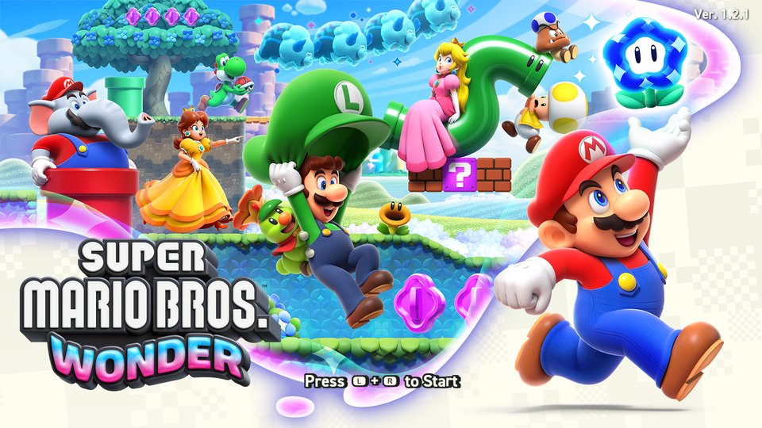<br>Super Mario Bros. Wonder | 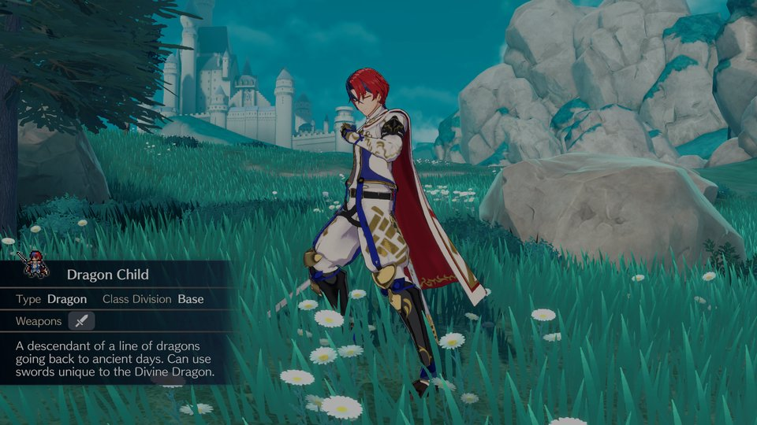<br>Fire Emblem Engage |
| 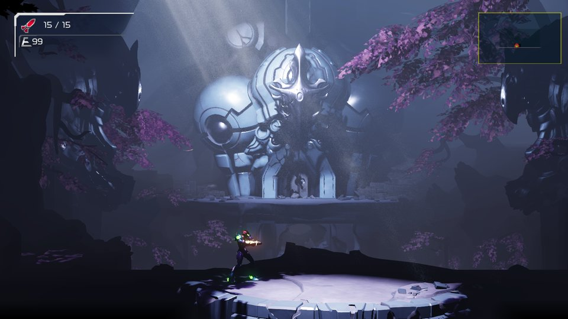<br>Metroid Dread | 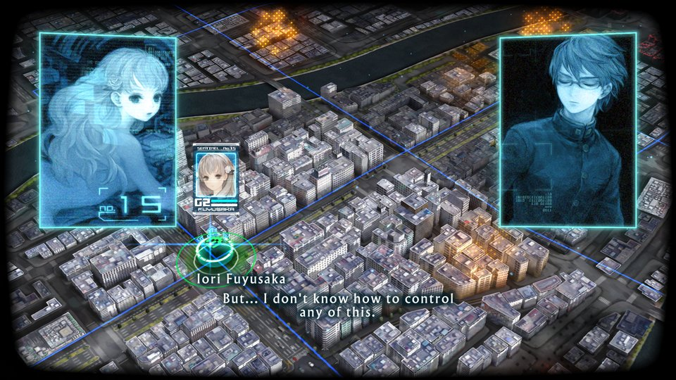<br>13 Sentinels: Aegis Rim |
| 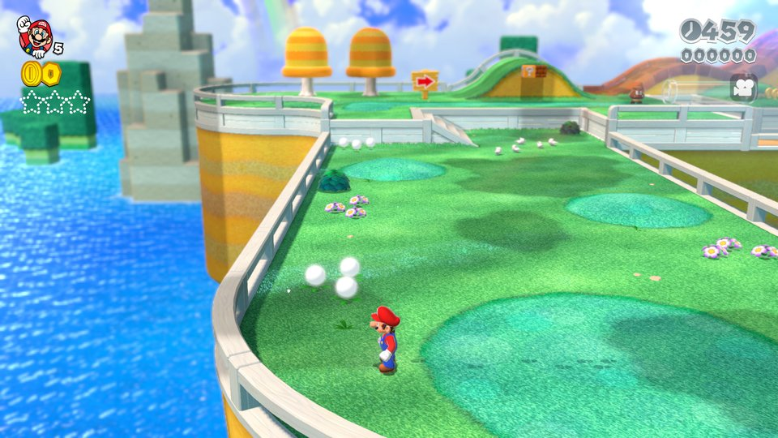<br>Super Mario 3D World + Bowser's Fury | 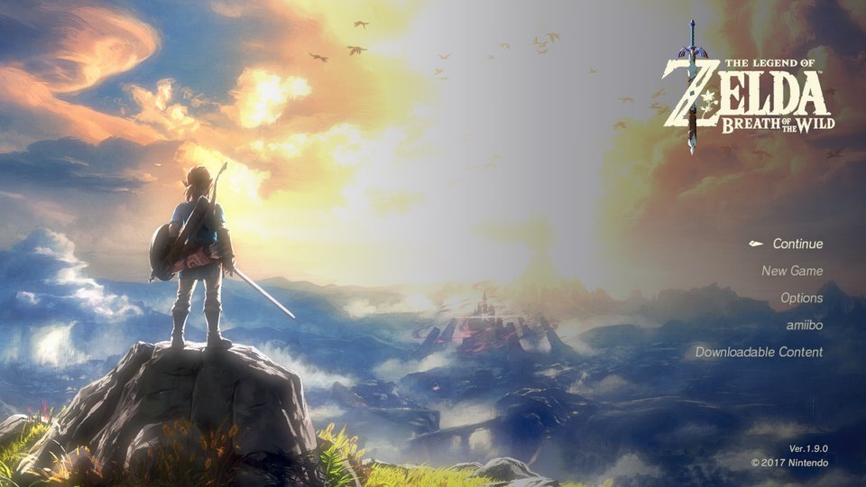<br>The Legend of Zelda: Breath of the Wild |
| 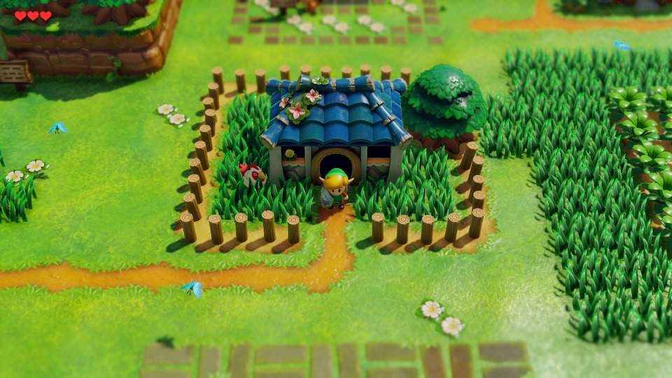<br>The Legend of Zelda: Link's Awakening | 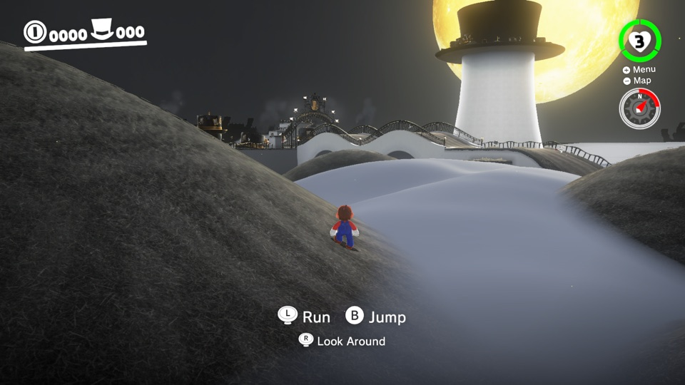<br>Super Mario Odyssey |
| 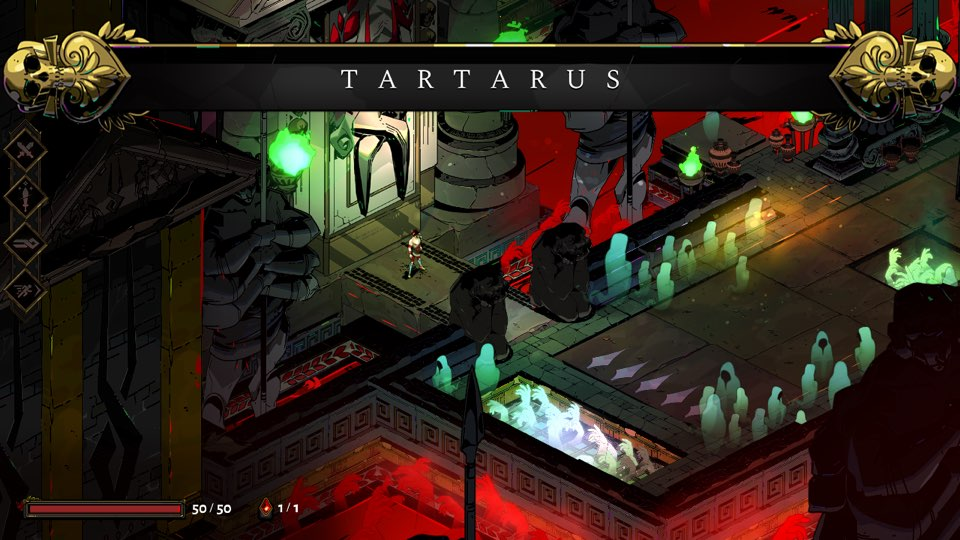<br>Hades | 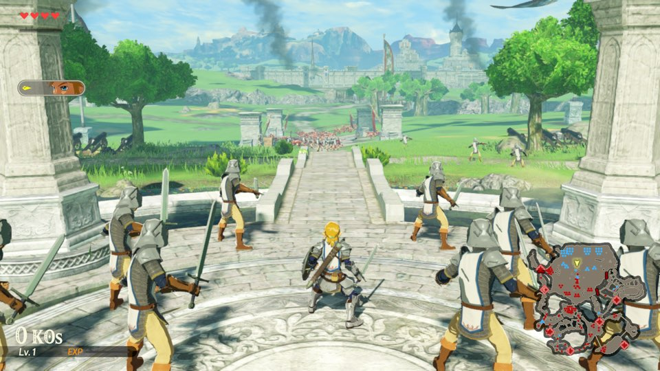<br>Hyrule Warriors: Age of Calamity |
| 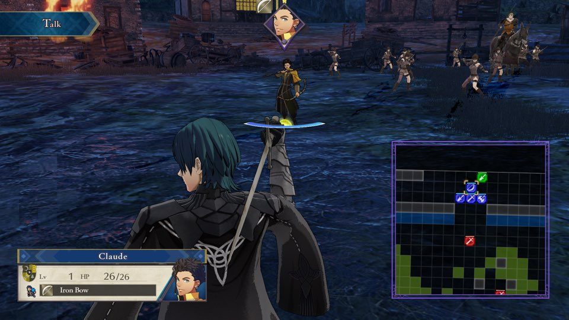<br>Fire Emblem: Three Houses | 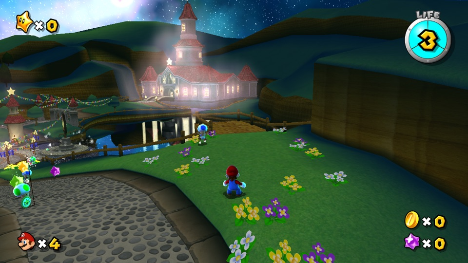<br>Super Mario Galaxy |
| 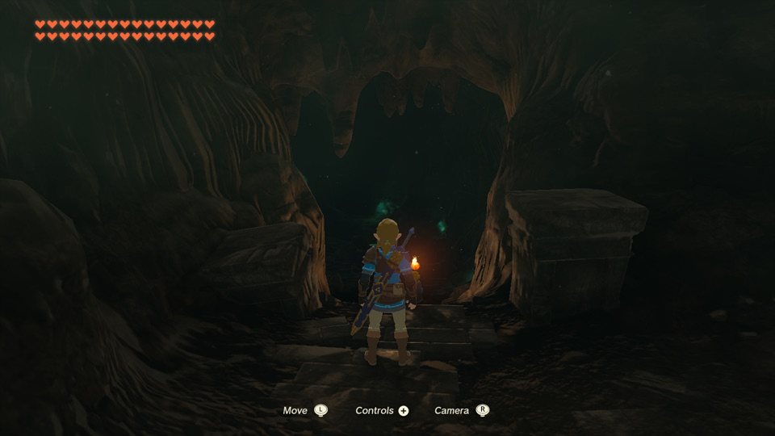<br>The Legend of Zelda: Tears of the Kingdom | |

Needs iOS / iPadOS 26 or later on an iPhone 15 Pro or newer (A17 Pro chip or later) or an iPad with an M1 chip or later: the games' textures are BC-compressed, and older iPhones can't read that format. Other games aren't supported yet. For them the script writes a survey and still tries its best to pack an IPA, guessing the game's settings; such an IPA may not start.

## Pack an IPA

**1. Get ouncenative and its tools** (once, on a Mac with [Xcode](https://apps.apple.com/app/xcode/id497799835) and [Homebrew](https://brew.sh)):

```
git clone https://github.com/kirakira-dev/ouncenative.git
cd ouncenative
brew install xcodegen zstd spirv-cross
brew install --cask dotnet-sdk
python3 -m pip install lz4 capstone fonttools
```

**2. Put one game's NSPs in a folder**, base game and update (and any DLC):

```
~/Games/MarioWonder/
  Super Mario Bros. Wonder [010015100B514000][v0].nsp
  Super Mario Bros. Wonder [010015100B514800][v327680].nsp
```

**3. Run the script:**

```
python3 scripts/build_ipa_from_nsp.py ~/Games/MarioWonder -k ~/keys/prod.keys
```

The IPA appears in the same folder (here `~/Games/MarioWonder/SMBWMobile.ipa`). The first build takes 30–60 minutes, later ones about 10. You need free disk space of about twice the NSPs' size plus 10 GB. Options such as `-o` (output path) and `--app-name` are listed by `-h`.

**4. Install** the IPA with your sideloading tool (AltStore, Sideloadly, LiveContainer, …). The app gets the game's name, icon and version (the update's version, for example 1.2.1 for Mario Wonder; the base game's when there is no update).

## Play

**Touch controls.** Tap **2D** / **3D** at the top to switch layouts; the app remembers your choice. Wonder, Engage, Dread, 13 Sentinels and Link's Awakening start in 2D, the other games in 3D. In Super Mario Galaxy, touches outside the controls move the pointer.
A connected game controller hides the touch controls and keeps every button.

- **Game language** is English by default. For Chinese, add the line `DM_LANG=zh-Hans` to `Documents/env.txt`.
- **Saves and logs** are in the Files app, under the app's name: `save/` and `log.txt`. When something goes wrong, send `log.txt` (the previous run is `log.prev.txt`).
- **Short stutters** the first time a new scene appears are normal: the app compiles graphics for it once and remembers them for the next launch.
- **Reinstalling:** some sideloading tools give a reinstalled app a new data folder. Copy `save/` and `pso_user.tsv` over from the old one to keep your progress.
- **Settings without rebuilding:** put lines like `DM_OPMODE=0` (handheld mode: lower resolution, higher frame rate) in `Documents/env.txt`.

## Known issues

- No amiibo and no online features.
- Fire Emblem Engage: after switching away from the app and back, some sounds may stay silent until you restart it.
- Fire Emblem: Three Houses: small square patches on the ground where decals land.
- Super Mario Galaxy: effects drawn as points or lines come out one pixel wide.
